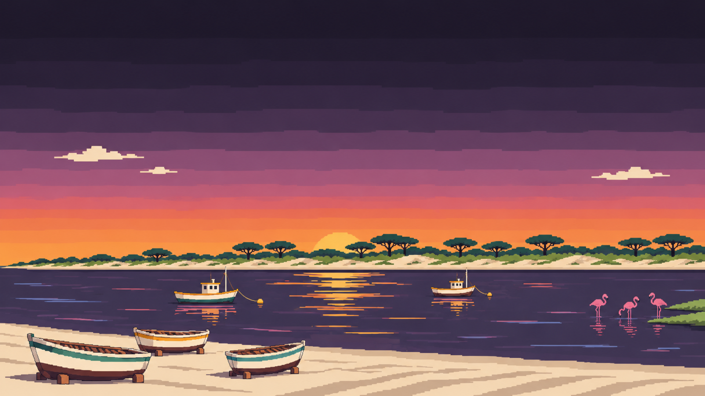

# Sanlúcar Dark

A dark [Omarchy](https://omarchy.org/) theme showing the view from Sanlúcar de Barrameda, Spain, at sunset: the sun dropping behind Doñana's pines across the Guadalquivir, a dusk sky of indigo and plum, ember and gold light on the water, and the pink afterglow over the Bonanza salt pans.



## Install

```bash
omarchy theme install https://github.com/almaro90/omarchy-sanlucar-dark-theme
omarchy theme set sanlucar-dark
```

For the daytime version, see [Sanlúcar Light](https://github.com/almaro90/omarchy-sanlucar-light-theme).

## Palette

| Role | Color | Inspiration |
| --- | --- | --- |
| Background | `#1D1A28` | Dusk over Doñana |
| Foreground | `#F1E1CB` | Sand in the last light |
| Accent | `#F2963F` | The sun on the river mouth |
| Red | `#E2634B` | Embers |
| Orange | `#F2963F` | Sunset |
| Yellow | `#F2C35E` | Sun gold, manzanilla |
| Green | `#9DB36E` | Pines in the last light |
| Cyan | `#62B0A6` | Guadalquivir |
| Blue | `#7E92CC` | Dusk sky |
| Magenta | `#D97FA6` | Afterglow, flamingos |
| Brown | `#A9744A` | Sherry casks |

Window borders run from sun orange to afterglow pink. Icons use Yaru-dark.

## Backgrounds

The default is a pixel-art view of the river mouth at sunset. The others are photos from Wikimedia Commons, released under CC BY-SA. Sources and licenses are listed in [CREDITS.txt](CREDITS.txt).
